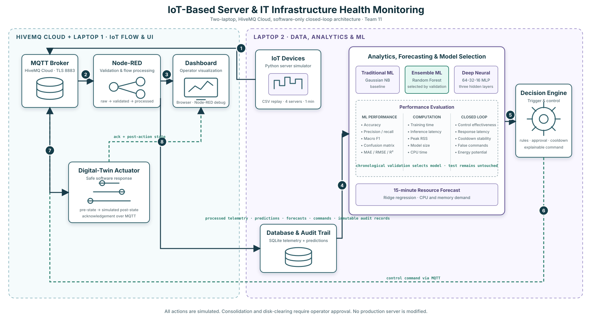
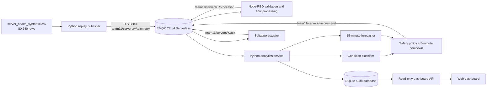

# System architecture

## Trust boundaries

- The CSV labels are available during training and evaluation only.
- MQTT telemetry contains sensor fields, timestamp and server ID; it does not
  contain the true condition, fault type or expected action.
- ML estimates condition and demand. A deterministic policy validates every
  proposed action and implements a per-server/action cooldown.
- Consolidation and disk-clearing recommendations require operator approval.
- The actuator is intentionally simulated and cannot modify a real server.
- EMQX Cloud connections use verified TLS plus a project-only username and
  password loaded from an ignored local environment file.

## MQTT topics

| Topic | Producer | Consumer | Purpose |
|---|---|---|---|
| `team11/servers/{id}/telemetry` | replay | Node-RED | Raw sensor readings |
| `team11/servers/{id}/processed` | Node-RED | analytics | Validated/enriched sensor readings |
| `team11/servers/{id}/prediction` | analytics | Node-RED | Condition probabilities and forecast |
| `team11/servers/{id}/command` | policy | actuator, Node-RED | Controlled resource action |
| `team11/servers/{id}/ack` | actuator | Node-RED | Simulated execution result |
